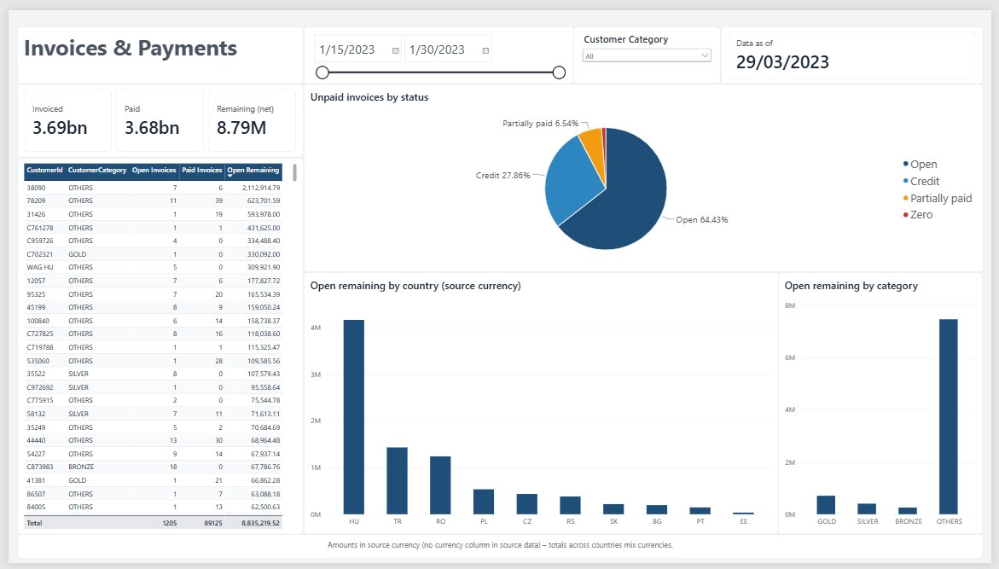

# Invoices & Payments – Azure data pipeline

Take-home assignment for a data engineering role. Source files with customers, invoices and payments are loaded
daily from Azure Storage into Azure SQL Database with Azure Data Factory, transformed with SQL into a reporting model
and shown in a Power BI report.

## Architecture

```
Azure Blob Storage          Azure Data Factory                 Azure SQL Database                       Power BI
(source files)              (orchestration, daily trigger)

DS1_Customers.txt  ─┐
DS2_Invoices.xlsx  ─┼──>  pl_load_stage (3 Copy)  ──>  stage  (raw text)
DS3_Payments.csv   ─┘     pl_load_core  (3 SP)    ──>  core   (clean, typed, keys, MERGE)
                                                       mart   (dim_customer, dim_date, fct_invoice)  ──>  report
                                                       meta   (load_log)
```

- **Azure Data Factory** only moves files and runs stored procedures. All transformations are in SQL.
- `pl_master_daily` runs `pl_load_stage` and then `pl_load_core` once a day (trigger `tr_daily`).
- Every layer supports daily loads: stage is truncated and reloaded, core is loaded with MERGE (rerun = no duplicates),
  mart views always read the current core data.

## Repository structure

```
adf/                         Data Factory JSON (pipelines, datasets, linked services, trigger) – Git integration
sql/
  00_analysis/               source data analysis (question -> query -> result -> conclusion)
  01_stage/                  stage schema and tables
  02_core/                   core + meta tables, load procedures for customers, invoices, payments
  03_mart/                   mart views and calendar table for Power BI
powerbi/
  invoices_report.pbix   <- the report itself (open in Power BI Desktop)
  invoices_report.pdf    <- static export for people without Power BI
  report.png             <- screenshot shown in README
docs/
  data_analysis.md           source data issues and business rules
  design_decisions.md        why the solution is built this way, next steps
```

## Source data issues (summary)

| Area | Finding | Handling |
|---|---|---|
| Duplicates | 35 exact duplicate customers | deduplicated in core |
| Types | payment dates in `dd.mm.yyyy` | converted in core (style 104) |
| Joins | 79 payment rows without invoice (invoices missing in the extract) | kept with `IsOrphan = 1`, not in the report |
| Amounts | no currency column, HU = 77 % of all money; credit and zero invoices | kept as is, statuses Credit / Zero, question for business |
| Dates | payments up to 5 years before the invoice (old credit applied) | kept; report filter = invoice date |
| Document types | 5 types, all of them settle invoices | paid = signed sum of all types |
| Paid vs invoiced | 98.1 % paid, one 0.03 difference | status with tolerance 0.05 |

Details: [docs/data_analysis.md](docs/data_analysis.md).

## Report



Filters: invoice date range, customer category.

- **(a)** total invoiced, paid and remaining (net) amounts
- **(b)** customer list with the number of open invoices, paid invoices and remaining amount of open
  (unpaid or partially paid) invoices
- **(c)** insights: unpaid invoices by status, open remaining by country and by customer category

Key findings:
- 98 % of invoices are fully paid; 8.8 M is still open, 95 % of it in invoices with no payment at all.
- Most of the open amount belongs to customers in category OTHERS.
- Statuses are valid as of 29.03.2023 (last payment in the data).
- Amounts are in source currency, so totals across countries mix currencies.

## How to run

1. Upload the three source files to the Blob Storage container.
2. Run the SQL scripts in order: `sql/01_stage`, `sql/02_core` (tables, then procedures), `sql/03_mart`.
3. In Data Factory run `pl_master_daily` (or wait for the daily trigger).
4. Check the load: `select * from meta.load_log order by RunId desc;`
5. Open `powerbi/*.pbix` and refresh (Azure SQL connection, Import mode).

Credentials are not stored in this repository.

## Open questions for the business

1. In which currency are the amounts?
2. What is the document type `Blank`?
3. Where are the 56 invoices referenced by orphan payments?
4. Is a tolerance of 0.05 for cent differences acceptable?
